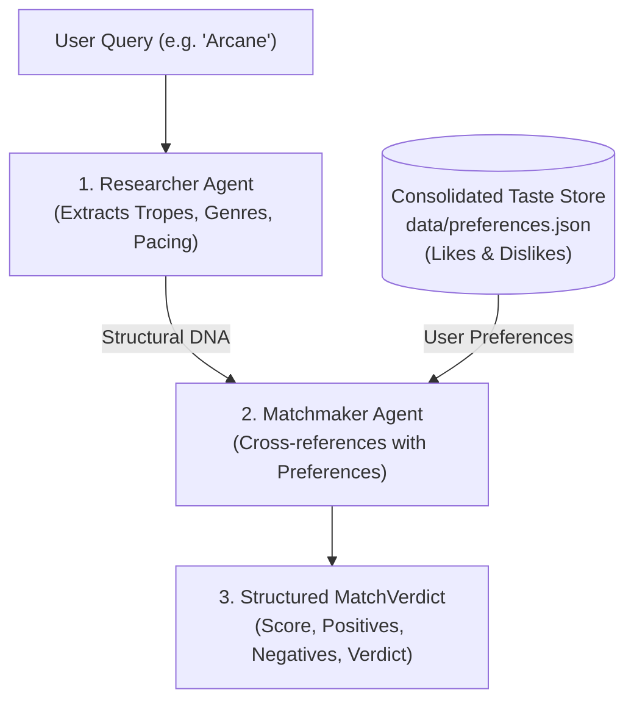

# Personalized Media Matchmaker AI (Second Brain)

A local-first CLI that turns your personal media reviews into a "Second Brain" to match you with books, novels, shows, movies, anime, and manhwa. 

The system leverages a multi-agent pipeline built with [Pydantic AI](https://ai.pydantic.dev/):
1. **Researcher Agent** extracts the structural "DNA" (genres, storytelling tropes, pacing, character archetypes) of candidate media without spoilers.
2. **LocalRAG Engine** indexes your personal Markdown reviews and retrieves past reactions to those exact tropes and genres.
3. **Profiler Agent** analyzes your preferences specifically concerning the candidate media's themes.
4. **Matchmaker Agent** cross-references user preference against media traits to deliver a structured compatibility score, positive/negative coincidences, and verdict.
5. **Ingestor Agent** archives your unstructured thoughts into structured Markdown reviews.

---

## Requirements

- macOS, Linux, or Windows supported by [uv](https://docs.astral.sh/uv/) or Python
- Python >= 3.10 (tested on Python 3.10 through 3.15)
- A Google Gemini API key (obtainable for free from [Google AI Studio](https://aistudio.google.com/))

---

## Setup

Install `uv` if it is not already available. On macOS with Homebrew:

```bash
brew install uv
```

From the project directory, create the virtual environment and install dependencies:

```bash
uv venv .venv
uv pip install -r requirements.txt
```

Create a `.env` file in the project directory:

```dotenv
# Google Gemini API Key from Google AI Studio (https://aistudio.google.com/)
GEMINI_API_KEY=your_gemini_api_key_here

# Optional: Override the model (defaults to google:gemini-2.5-flash)
LLM_MODEL=google:gemini-2.5-flash

# Required for function calling and structured outputs with Google GenAI
GOOGLE_GENAI_API_VERSION=v1beta
```

> **Security Note:** Never commit `.env` to version control; it is ignored by `.gitignore`.

---

## CLI Usage

Activate the virtual environment and launch the CLI:

```bash
source .venv/bin/activate
python main.py
```

### Commands

Type `/` at the prompt to trigger the **interactive command menu**. Use the **Up and Down arrow keys** to highlight a command and press **Enter** or **Tab** to select:

| Command | Description |
| :--- | :--- |
| `<media title>` | Enter any title with its type of media (e.g. `Arcane`, `Dune`, `Solo Leveling`) to receive an instant match verdict against your preference preferences. |
| `/review [text]` | Ingest free-form thoughts into your centralized preference memory (updating liked & disliked tropes). |
| `/list` | List all media titles currently logged in your history. |
| `/help` | Display interactive CLI help and available options. |
| `/quit` | Gracefully exit the CLI. |

### Adding a Review

You can add a review in two convenient ways:
1. **Slash Command:** Type `/review [text]` (or just `/review` and enter your thoughts when prompted).
2. **Natural Input:** Simply write your review naturally (e.g., `Jailer: Great story and unexpected twists, but too violent. Rating: 3/5`). The system automatically detects review patterns and routes them to the Ingestor.

```text
/review I loved the fast pacing and clever protagonist in Omniscient Reader, but the side characters needed more screen time. 5/5.
```

The Ingestor extracts structured likes, dislikes, title, and rating, merges them directly into your consolidated preference knowledge base (`data/preferences.json`), and archives the formatted review into the designated media category Markdown file:
* **Movies:** `data/movies.md`
* **Shows & Series:** `data/shows.md`
* **Manhwa, Manga & Anime:** `data/manhwa.md`
* **Novels & Books:** `data/novels.md`

---

## How It Works



1. **Structural Analysis (Researcher):** Breaks down the target media into its core structural DNA without plot spoilers.
2. **Consolidated Taste Store (`preferences.json`):** Rather than reading dozens of separate markdown files (which bloat LLM context and cause hallucinations), your core likes and dislikes are aggregated into a single, clean knowledge base.
3. **Structured Matching (Matchmaker):** Directly cross-references candidate media traits against your confirmed likes and dislikes to produce a validated `MatchVerdict` (compatibility percentage 0-100, recommendation tier, positive coincidences, watch-outs, and verdict).
4. **Continuous Learning (Ingestor):** When you review media via `/review`, the Ingestor extracts new liked and disliked tropes and merges them into `preferences.json`.

---

## Preferences Data Format

Your preferences are consolidated in `data/preferences.json`:

```json
{
  "likes": [
    "Clever, strategic protagonists who use planning rather than brute strength",
    "High stakes from the start without dragging out initial setup",
    "Morally grey characters who make ruthless, calculated survival decisions"
  ],
  "dislikes": [
    "Supporting characters fading into the background during major solo arcs",
    "Slow, dragging middle pacing with excessive filler"
  ],
  "history": [
    {
      "title": "Omniscient Reader's Viewpoint",
      "type": "Web Novel / Manhwa",
      "rating": "5/5"
    }
  ]
}
```

---

## Testing & Evaluation

Run the automated test suite:

```bash
python evaluate.py
```

```Standard virtual environment activation
source .venv/bin/activate
python evaluate.py
```

```Using uv
uv run evaluate.py
```                     

The suite validates:
1. **PII Sanitization Guardrail:** Verifies that international and formatted phone numbers, emails, and usernames are scrubbed while preserving benign numbers.
2. **LocalRAG Ingestion & Retrieval:** Tests keyword tokenization, stopword removal, and trope overlap scoring.
3. **Pydantic Schemas:** Asserts model validation and constraint bounds for `MediaReview`, `MediaResearch`, and `MatchVerdict`.
4. **Offline Agent Pipeline:** Simulates end-to-end execution of Ingestor and Matchmaker agents using Pydantic AI's offline `TestModel` without requiring network access or API credentials.

---

## Project Structure

```
.
├── README.md               # Project documentation
├── requirements.txt        # Python dependencies
├── .env                    # Environment variables and API keys (git-ignored)
├── .gitignore              # Ignored files and directories
├── main.py                 # Non-blocking interactive CLI
├── agents.py               # Pydantic AI agent definitions
├── models.py               # Pydantic data schemas (MediaReview, MediaResearch, MatchVerdict)
├── rag.py                  # Token-based LocalRAG engine with stopword filtration
├── guardrails.py           # Regex-based PII redaction filter
├── evaluate.py             # Automated test suite (7 test suites)
└── data/                   # Categorized review archives & preference store
    ├── preferences.json    # Consolidated likes, dislikes & history
    ├── movies.md           # Movie reviews
    ├── shows.md            # TV & series reviews
    ├── manhwa.md           # Manhwa, manga & anime reviews
    └── novels.md           # Novel & book reviews
```

---

## Troubleshooting

- **Authentication / API Key Error:** Verify that `.env` contains a valid `GEMINI_API_KEY` created in [Google AI Studio](https://aistudio.google.com/). Ensure there are no extra quotes or whitespace.
- **Alternative LLM Providers:** The codebase also supports Anthropic, OpenAI, or Ollama. Set `LLM_MODEL` in your `.env` (e.g. `LLM_MODEL=anthropic:claude-3-5-sonnet-latest` or `LLM_MODEL=openai:gpt-4o-mini`) alongside the corresponding provider API key.
- **Pydantic AI Observability Banner:** Hidden by default via `PYDANTIC_AI_NO_BANNER=1`. To enable Pydantic Logfire tracing, set up `logfire` or remove the environment variable.
